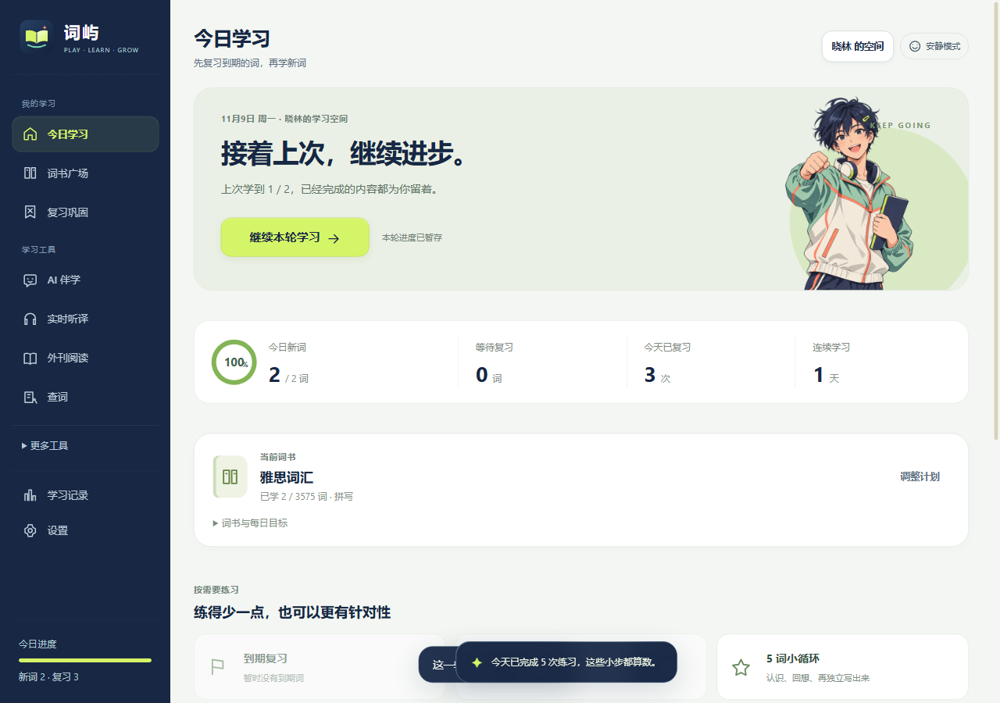
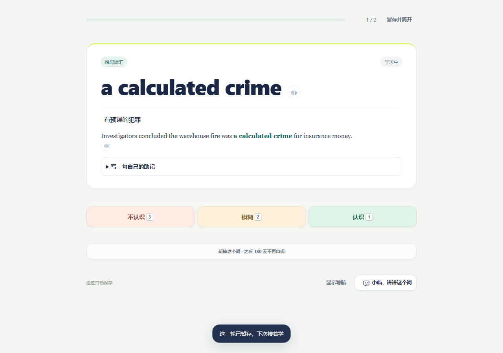
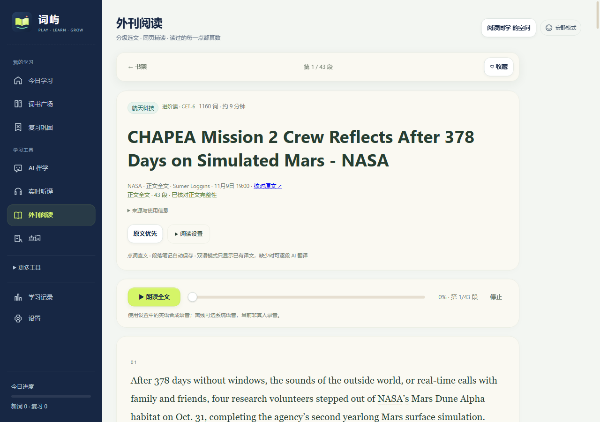
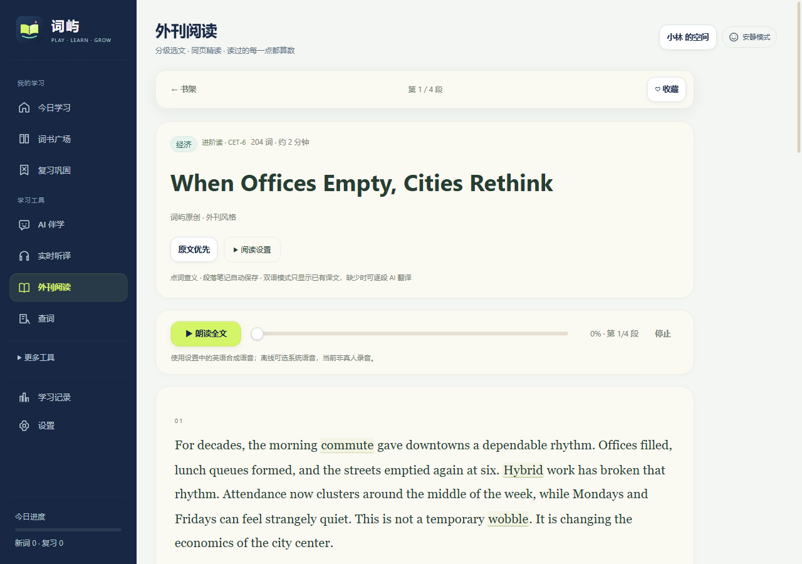

<div align="center">


# 词屿 · Word Isle

**每天一点，词自成屿。**

离线可用的英语学习桌面应用 · Windows 10 / 11 (x64) · 本机账号 · 数据只留在本机

### [⬇ 点击此处下载（官网下载区）](https://1752370874-blip.github.io/wordisle/#download)

[官网](https://1752370874-blip.github.io/wordisle/) · [GitHub Releases](https://github.com/1752370874-blip/wordisle/releases/latest) · [v3.9.35 更新说明](https://github.com/1752370874-blip/wordisle/releases/tag/v3.9.35-preview)

</div>

---

> **当前版本：v3.9.35-preview（竞赛体验版）**
> 相比 3.9.3 新增：站内阅读全文、16 个外刊来源与 150 篇官方全文、本地 AI 伴学与离线翻译、42 本词书、本机加密账号、五词闯关。

## ⬇ 下载

| 文件 | 大小 | 说明 |
| --- | --- | --- |
| **[WordIsle-3.9.35-preview-win-x64.zip](https://github.com/1752370874-blip/wordisle/releases/latest/download/WordIsle-3.9.35-preview-win-x64.zip)** | 293 MB | **主包**：程序本体 + 42 本词书与 65k 查词词典 + 150 篇全文 + 断句/语音小模型。解压即可用 |
| [WordIsle-3.9.35-models-qwen3-1.7b.zip](https://github.com/1752370874-blip/wordisle/releases/latest/download/WordIsle-3.9.35-models-qwen3-1.7b.zip) | 1.22 GB | 可选：本地 AI 伴学、讲解、听译解析与交叉复核（Qwen3-1.7B Q4_K_M） |
| [WordIsle-3.9.35-models-hy-mt2.zip](https://github.com/1752370874-blip/wordisle/releases/latest/download/WordIsle-3.9.35-models-hy-mt2.zip) | 1.08 GB | 可选：本地离线翻译（Hy-MT2-1.8B Q4_K_M） |

**安装**：解压主包 → 双击 `WordIsle.exe` → 注册本机账号（可勾选把旧版本机记录迁入）。全部下载约 2.6 GB，解压后合计约 7 GB，建议 Windows x64、8 GB 内存以上（16 GB 更稳），不需要独立显卡。

**装本地 AI**：下载模型包，把解压出的 `resources/app/app/models/` 合并进主包的同名目录（提示覆盖时选合并）即可。不装也能正常背词、查词、阅读，只是本地 AI 伴学与离线翻译会提示模型缺失；也可以在设置里改用在线 API 模式。

> GitHub 单个发布文件上限 2 GB，所以本地模型拆成两个独立资产分发；二进制与模型都不进 Git 历史（`.gitignore` 已排除 `*.zip`、`models/`）。
> 校验值见 Release 说明与仓库根的 [SHA256SUMS.txt](SHA256SUMS.txt)。

---

## 本次版本：v3.9.35-preview

- **站内阅读全文**：ScienceDaily、NPR、Smithsonian、Science News Explores 等来源的文章，点「阅读全文」直接在词屿自己的阅读窗口里打开官方完整页面，不再跳外部浏览器；支持返回书架、后退/前进、重新加载、原版页面与文字缩放。NPR 优先用官方纯文字版。
- **150 篇内置全文 + 16 个来源**：正文从原网页正文区域提取，保留到最后一段，支持点词查义、段落笔记、收藏、阅读位置与离线阅读；未取得全文的入口明确标注，不用摘要冒充全文。
- **文章来源栏目修复**：修复「全文阅读」选中 NPR 显示 0 篇的问题；默认书架改为「全部文章」，另有「站内全文」「原站全文」标签。
- **本地 AI**：随包 Qwen3-1.7B（伴学、讲解、听译解析）与 Hy-MT2-1.8B（离线翻译），Windows x64 CPU 推理，不需要 Ollama / Python / CUDA；也可以切换到在线 API 模式。
- **本机加密账号**：注册即得 `WI-` 开头的本机 ID，学习进度、笔记、资料按账号加密保存；支持记住密码 / 自动登录、锁定、恢复密钥与 `.wiaccount` 加密备份。
- **42 本词书**：小学到 GRE 分册，74,278 条词书收录、16,521 个去重词形；每日 1—300 词目标、SM-2 间隔复习、五词小循环与薄弱项补练。
- **学习流程重构**：首页「开始学习」按当前词书出题，每组最多 10 词、复习优先，支持「继续本轮」与暂存离开；四步新手引导。
- **朗读高亮修复**：高亮边线与文字之间固定留白，播放、暂停、拖动都不再改变段落宽度。
- **统一新图标**：程序文件、窗口、任务栏、启动页、登录页与侧栏统一为书页 + 小岛弧线 + 星光。
- **界面**：液态玻璃在 GPU 合成下约 160fps，可一键关闭；暖纸 / 清爽 / 夜读三种背景，窄窗口布局完整。

完整说明见 [docs/使用说明-3.9.35.md](docs/使用说明-3.9.35.md)，逐项验证记录在 [docs/验证数据/](docs/验证数据/)。

---

## 功能

- **九本考试词库 + 42 本词书广场**：CET-4/6、考研、雅思、托福、GRE、牛津 3000/5000、柯林斯五星，SM-2 间隔重复（前密后疏的 5 分钟 → 90 天档位）。
- **65,000 词本地词典**：输入即查，中英互查；音标、词性、释义、例句离线可用。
- **外刊订阅与全文阅读**：16 个来源频道，150 篇经完整性校验的官方全文，6/12/24 小时自动检查，最多 1500 条公共缓存。
- **本地 AI 伴学**：小屿讲解、全文翻译与逐段讲解、听力解析；本地推理不外发资料，选 API 模式时才按界面提示发送。
- **三音源朗读**：单词用有道美音/英音，整句用微软在线神经语音或百度翻译，断网自动回退系统语音；高亮逐词跟随。
- **五种练法 + 五词闯关**：翻卡、四选一、例句填空、拼写、听写；闯关三步走、错词本专项补练、连续打卡。
- **本机账号与加密空间**：等级 / 记录 / 笔记按账号隔离，支持锁定、恢复密钥、加密备份与 JSON 明文导出。
- **液态玻璃界面**：浅色纸感 + 发丝高光，可关闭动效与大幅插画（安静模式）。



| 专注学习 | 全文阅读 |
| --- | --- |
|  |  |

| 外刊精读 | 外刊自动更新 |
| --- | --- |
|  |  |

> 全部 38 张界面与验证截图在 [shots/](shots/)。

---

## 仓库结构

```
wordisle/
├─ index.html / app.js / styles.css           渲染层（纯 HTML/CSS/JS）
├─ main.js / preload.js                        Electron 主进程与预加载
├─ account-*.js / account-*.css               本机账号、加密学习空间、登录偏好
├─ article-reader-* / reading-*.js            站内全文阅读窗口、外刊抓取与来源
├─ local-model.js / translation-*.js          本地 AI（Qwen3 / Hy-MT2）与翻译链路
├─ speech-*.js / vad-*.js / boundary-*.js     朗读、断句、听译
├─ data/                                      42 本词书、65k 查词词典、150 篇全文、来源索引、pdfjs
├─ training/                                  断句模型与翻译记忆的训练脚本 + UD 数据
├─ assets/                                    程序图标与插画说明
├─ local-runtime/ speech-runtime/ reading-runtime/
│                                             各自 package.json / package-lock.json（node_modules 用 npm ci 还原）
├─ desktop/                                  便携版、NSIS 安装包、macOS 构建脚本
├─ site/                                     官方网站源码（纯静态）
├─ docs/                                     使用说明、各类验证文档、验证数据/
└─ shots/                                    界面截图
```

本地模型（`models/`，约 2.4 GB）不进仓库，从 Release 的模型包获取；`node_modules` 也不进仓库，用 `npm ci` 按 lock 还原。

## 本地运行（开发）

```bash
# 1) 主程序依赖（在线朗读用 edge-tts）
npm install

# 2) 三个运行时依赖（本地 AI、离线朗读/听译、全文提取）
for d in local-runtime speech-runtime reading-runtime; do (cd $d && npm ci); done

# 3) 模型：把 Release 模型包解压到 models/ 下（Qwen3-1.7B-Q4_K_M.gguf、hy-mt2/）
# 4) 启动
npx electron .
```

只调界面时也可以 `cd site && python -m http.server 8123`，或直接用静态服务器打开 `index.html`（朗读/抓新闻需要 Electron）。

## 构建发布包

```bash
# 便携版（Windows）：Electron 运行时 + 应用文件 + data + 模型 → desktop/单词本/
node desktop/package.mjs

# NSIS 安装包：产物在 desktop/installer/dist/
cd desktop/installer && npm install && node build.mjs
```

macOS 包必须在 macOS 上构建（`codesign` / `hdiutil` / 公证只有 macOS 提供）：

```bash
cd desktop/macos-build && ./build-macos.sh
```

也可以在 GitHub Actions 里手动触发 `.github/workflows/build-macos.yml`，在 `macos-14` runner 上免费产出 DMG。

## 官网

官网是 `site/` 目录下的纯静态页面（`index.html` + `styles.css` + `config.js` + `site.js` + `assets/`），没有构建步骤：

- 线上地址：<https://1752370874-blip.github.io/wordisle/>
- 站点里的「点击此处下载」按钮，链接取自 `site/config.js` 的 `winDownload`：

```js
window.SITE_CONFIG = {
  version: '3.9.35-preview',
  winDownload: 'https://github.com/1752370874-blip/wordisle/releases/latest/download/WordIsle-3.9.35-preview-win-x64.zip',
  github: 'https://github.com/1752370874-blip/wordisle'
};
```

本地预览：`cd site && python -m http.server 8123`，打开 <http://127.0.0.1:8123>。
部署方式：把 `site/` 推送到本仓库的 `gh-pages` 分支，GitHub Pages 即以该分支根目录发布；详细步骤见 [site/DEPLOY-CN.md](site/DEPLOY-CN.md)。

> 大陆网络访问 `*.github.io` 可能偏慢。如需国内 CDN，可把 `site/` 目录原样上传到任意静态托管，只改 `config.js` 的下载直链即可。

## 数据与隐私

- 没有云端账号：注册得到的是**本机账号**，学习和笔记按账号加密保存在本机，不上传账号服务器、不自动跨设备同步；
- 不接入统计、广告或第三方追踪脚本；
- 本地 AI 推理不向外部服务发送资料；只有选择在线 API 模式时才按界面中的发送确认发出；
- 在线朗读与新闻抓取需要联网，断网时朗读回退系统语音、阅读回退已缓存正文；
- 文章全文与笔记只在本机缓存，可在设置里清除。

## 许可与致谢

源码与界面：© 2026 词屿，保留所有权利。公开仓库是为了便于分发、构建与问题反馈，**不代表**允许商业再分发或二次打包发布，详见 [LICENSE](LICENSE)。

词库、语料与模型来自开源项目与公共领域作品（不是牛津词典原文）：

- **ECDICT**（MIT）—— 中文释义与音标数据
- **Oxford 3000 / 5000 公开词表** —— 词头与 CEFR 等级
- **Tatoeba**（CC BY 2.0 FR）与 **WordNet** —— 例句
- **CMUdict** —— 音标转写
- **Project Gutenberg** —— 公版经典选段
- **NASA / NPR / Smithsonian / ScienceDaily / MIT News 等** —— 外刊与新闻原文（按各站条款在软件内跳转或展示，不下载原站图片）
- **Qwen/Qwen3-1.7B**（Apache-2.0，ggml-org 量化）—— 本地伴学与讲解模型
- **Tencent Hy-MT2-1.8B-GGUF**（Apache-2.0）—— 本地离线翻译模型
- **OpenAI Whisper tiny.en**（MIT）与 **Silero VAD** —— 听译与语音活动检测
- **node-llama-cpp / llama.cpp**（MIT）—— 本地推理运行时
- **Electron**（MIT）—— 桌面运行时
- **有道 / 百度 / 微软** —— 运行时在线朗读服务（不内置音频）

模型的许可原文随模型包分发（`models/LICENSE-Qwen.txt`、`models/hy-mt2/LICENSE.txt`、`MODEL-INFO.md`）。

## 免责与说明

- **v3.9.35-preview 是竞赛体验版**：使用独立数据目录 `%APPDATA%\WordIsle-Contest-Preview`，默认不与旧的 3.9.x 安装版共用学习记录；需要迁移时用「设置 → 导出学习 JSON」或在注册时勾选迁入旧版本机记录。
- 可执行文件没有购买 CA 代码签名证书，Windows SmartScreen 可能提示「未知发布者」：点「更多信息 → 仍要运行」即可。
- 首次打开会加载本地模型权重，需要几秒；五分钟空闲后自动释放内存。
- 小模型可能产生误译、遗漏与无依据的回答，请结合界面保留的原文核查。
