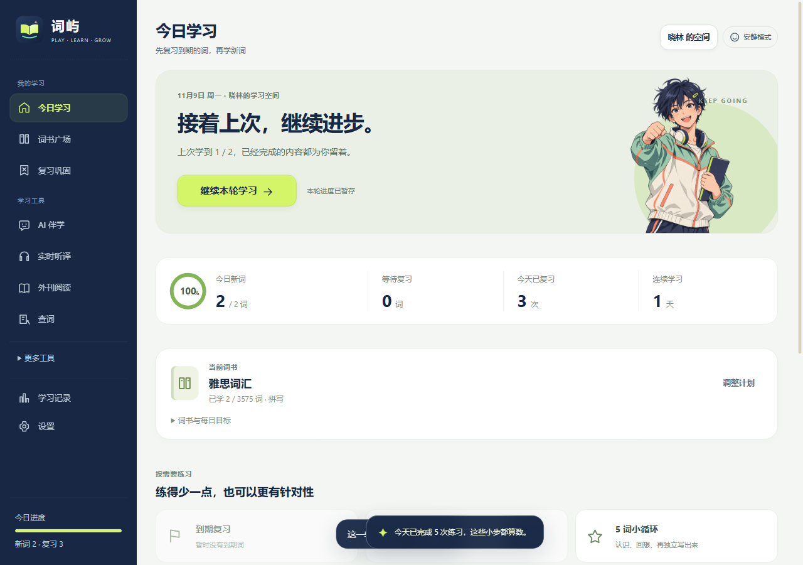
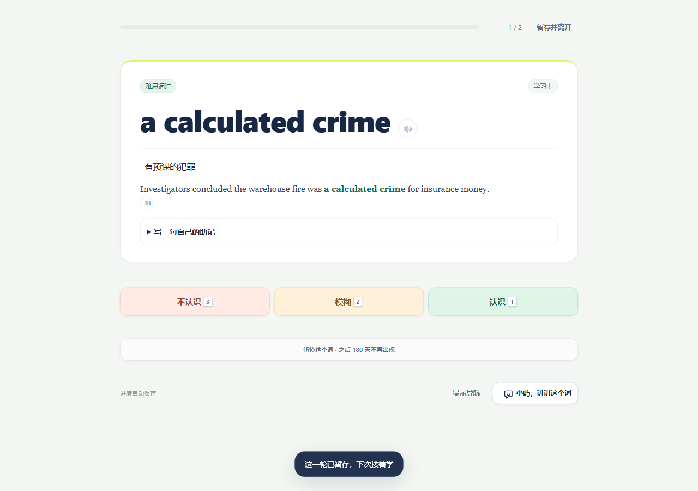
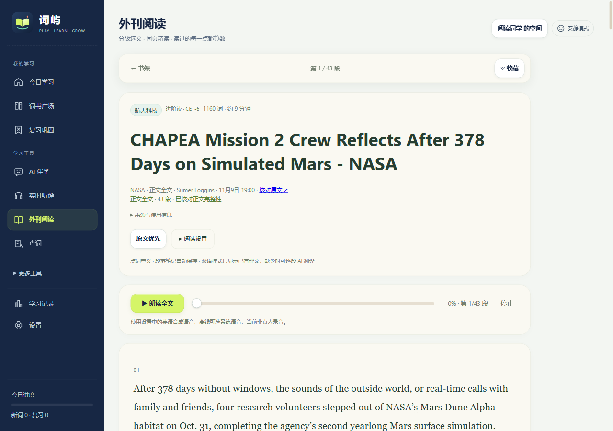
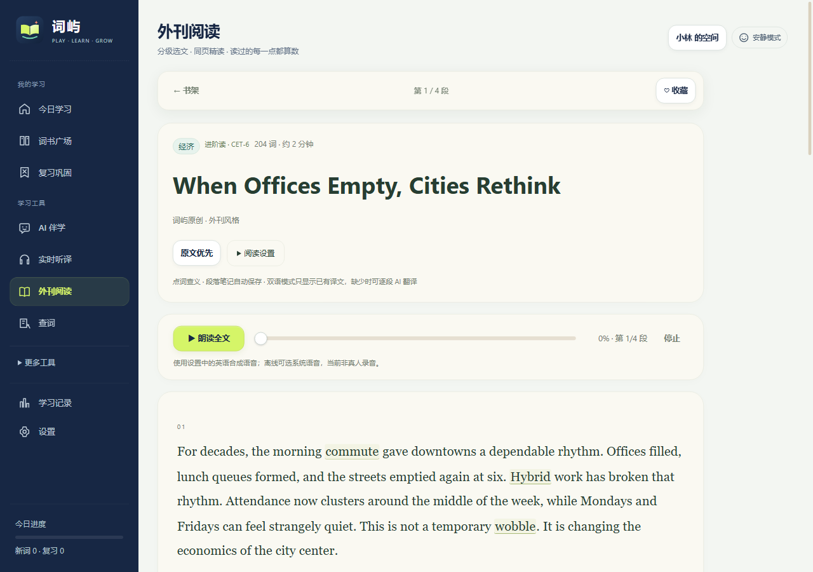

<div align="center">


# 词屿 · Word Isle

**每天一点，词自成屿。**

离线可用的英语学习桌面应用 · Windows 10 / 11 (x64) · 本机账号 · 数据只留在本机

### [⬇ 点击此处下载（官网下载区）](https://1752370874-blip.github.io/wordisle/#download)

[官网](https://1752370874-blip.github.io/wordisle/) · [GitHub Releases](https://github.com/1752370874-blip/wordisle/releases/latest) · [v3.9.56 更新说明](https://github.com/1752370874-blip/wordisle/releases/tag/v3.9.56-preview)

</div>

---

> **当前版本：v3.9.56-preview（参赛预览版）**
> 相比 3.9.35 新增：口语对练、一句话情景练习、770,610 条扩展词条、21 组同形异音词、词库导入（XLSX / TXT / CSV / JSON）、学习记录页、新版图标与标题栏；阅读、朗读、外刊来源和本地模型均有修复与增强。

## ⬇ 下载

| 文件 | 大小 | 说明 |
| --- | --- | --- |
| **[WordIsle-3.9.56-preview-Setup-x64.exe](https://github.com/1752370874-blip/wordisle/releases/latest/download/WordIsle-3.9.56-preview-Setup-x64.exe)** | 492 MB | **推荐**：Windows 安装包，双击按提示安装；升级 / 卸载保留本机账号与学习记录 |
| [WordIsle-3.9.56-preview-win-x64.zip](https://github.com/1752370874-blip/wordisle/releases/latest/download/WordIsle-3.9.56-preview-win-x64.zip) | 527 MB | **绿色版**：解压后双击 `WordIsle.exe`，不写安装记录 |
| [WordIsle-3.9.56-enhance-models.zip.001](https://github.com/1752370874-blip/wordisle/releases/latest/download/WordIsle-3.9.56-enhance-models.zip.001) / [.002](https://github.com/1752370874-blip/wordisle/releases/latest/download/WordIsle-3.9.56-enhance-models.zip.002) / [.003](https://github.com/1752370874-blip/wordisle/releases/latest/download/WordIsle-3.9.56-enhance-models.zip.003) | 3.73 GB | 可选：离线增强包（Qwen3-4B 伴学 / 对话、Hy-MT2 翻译、Whisper small、Pocket English），3 个分卷必须集齐 |

**安装版**：双击安装包 → 选择安装位置（默认 `%LOCALAPPDATA%\Programs\WordIsle`）→ 打开词屿 → 注册本机账号。安装包与绿色版已内置全部词书、全文数据、断句与轻量语音 / 翻译模型，核心功能完全离线。

**绿色版**：解压到任意目录（例如 `D:\词屿体验版`）→ 双击 `WordIsle.exe`。请保留整个文件夹，本地模型和运行组件都在 `resources` 里。

**离线增强包**：下载 `.001`、`.002`、`.003` 三个分卷放在同一目录，用 [7-Zip](https://www.7-zip.org/) 打开 `.001` 解压；把解压出的「词屿离线增强包」文件夹与词屿的程序文件夹放在**同一个父目录**下（例如 `D:\词屿离线增强包` 与 `D:\词屿体验版` 并列），重新打开词屿即可。只背词、查词、阅读、自然语音与英文转写可以不装。

> GitHub 单个发布文件上限 2 GB，所以离线增强包按 1.5 GB 分卷分发；二进制与模型都不进 Git 历史（`.gitignore` 已排除 `*.exe`、`*.zip`、`models/`）。
> 校验值见 Release 说明与仓库根的 [SHA256SUMS.txt](SHA256SUMS.txt)。

---

## 本次版本：v3.9.56-preview

- **口语对练**：左侧「口语对练」→「开始通话」，用英语自由聊天。说完稍停自动识别，小屿用语音回复后继续听；通话中可静音、挂断，或在回复时点「我来说」接过话轮。挂断后可点最后一句旁的「纠正上一句」，修改听写并请小屿重新接话。
- **一句话情景练习**：首页选择课堂 / 小组讨论 / 面试场景，用最近学过的词完成表达；可检查用词、听合成朗读，或请求本地 AI 解释与改写。草稿与建议随账号保存。
- **扩展词典**：离线词条增至 770,610 条（767,532 条含中文释义），常用 65,000 条支持中文反查；record、read 等 21 组同形异音词可按词性展开英 / 美读音，42 本词书补齐英美音标。
- **词库导入与学习记录**：词书广场可新建 / 删除个人词库；设置支持导入 XLSX、TXT、CSV 或 JSON（Excel 读取第一个工作表，至少含「单词」「释义」两列）；学习记录页提供每日报告、阶段图与薄弱词排行。
- **阅读与朗读**：150 篇官方全文 + 52 篇原创 / 经典材料；NPR 栏目「选中后 0 篇」已修复；朗读高亮不再遮挡段首单词。
- **界面**：程序文件、窗口、任务栏、启动页、登录页与侧栏统一为新图标；顶部标题栏融入界面，保留最小化 / 最大化 / 关闭，空白处可拖动窗口。
- **本地模型**：随包内置 Whisper base.en、Kokoro 英 / 美音色、Opus-MT 轻量英译中、Silero VAD 与英文句界模型；生成式伴学、自由对话、增强听写使用离线增强包（Qwen3-4B、Hy-MT2、Whisper small）。
- **检查更新**：联网增强模式下读取下载站的 `version.json`，发现新版本只提示、由用户手动下载，不自动安装。

完整说明见 [docs/使用说明-3.9.56.md](docs/使用说明-3.9.56.md)。

---

## 功能

- **口语对练与情景练习**：本地英语识别 + 小屿语音回复，支持打断、纠错与场景化表达练习。
- **九本考试词库 + 42 本词书广场**：CET-4/6、考研、雅思、托福、GRE、牛津 3000/5000、柯林斯五星，SM-2 间隔重复（前密后疏的 5 分钟 → 90 天档位）。
- **770,610 条离线词条**：中英互查，常用 65,000 条支持中文反查；音标、词性、释义、例句离线可用。
- **外刊订阅与全文阅读**：16 个来源频道，150 篇经完整性校验的官方全文，6/12/24 小时自动检查，最多 1500 条公共缓存。
- **本地 AI 伴学**：小屿讲解、全文翻译与逐段讲解、听力解析；本地推理不外发资料，选 API 模式时才按界面提示发送。
- **多音源朗读**：单词可试听英 / 美音与 0.5–2.0 倍语速，整句用微软在线神经语音或百度翻译，断网自动回退系统语音；高亮逐词跟随。
- **五种练法 + 五词闯关**：翻卡、四选一、例句填空、拼写、听写；闯关三步走、错词本专项补练、连续打卡。
- **本机账号与加密空间**：等级 / 记录 / 笔记按账号隔离，支持锁定、恢复密钥、加密备份与 JSON 明文导出。
- **液态玻璃界面**：浅色纸感 + 发丝高光，可关闭动效与大幅插画（安静模式）。



| 专注学习 | 全文阅读 |
| --- | --- |
|  |  |

| 外刊精读 | 外刊自动更新 |
| --- | --- |
|  |  |

> 全部界面与验证截图在 [shots/](shots/)。

---

## 仓库结构

```
wordisle/
├─ index.html / app.js / styles.css           渲染层（纯 HTML/CSS/JS）
├─ main.js / preload.js                        Electron 主进程与预加载
├─ account-*.js / account-*.css               本机账号、加密学习空间、登录偏好
├─ reading-*.js / reading-club-*              站内全文阅读、外刊抓取与来源
├─ oral-coach.js / oral-dialogue.js           口语对练、语音往返与纠错
├─ expression-practice.js / word-import.js    一句话情景练习、词库导入
├─ local-model.js / translation-*.js          本地 AI（Qwen3-4B / Hy-MT2）与翻译链路
├─ speech-*.js / vad-*.js / boundary-*.js     朗读、断句、听译
├─ data/                                      42 本词书、770k 词条、全文、来源索引、pdfjs
├─ training/                                  断句模型与翻译记忆的训练脚本 + UD 数据
├─ assets/                                    程序图标与插画说明
├─ local-runtime/ speech-runtime/ reading-runtime/ translation-runtime/
│                                             各自 package.json / package-lock.json（node_modules 用 npm ci 还原）
├─ desktop/                                  便携版、安装包与 macOS 构建脚本
├─ site/                                     官方网站源码（纯静态）
├─ docs/                                     使用说明、各类验证文档、验证数据/
└─ shots/                                    界面截图
```

本地模型（`models/`）不进仓库，从 Release 的安装包 / 增强包获取；`node_modules` 也不进仓库，用 `npm ci` 按 lock 还原。

## 本地运行（开发）

```bash
# 1) 主程序依赖（在线朗读用 edge-tts）
npm install

# 2) 四个运行时依赖（本地 AI、离线朗读/听译、全文提取、轻量翻译）
for d in local-runtime speech-runtime reading-runtime translation-runtime; do (cd $d && npm ci); done

# 3) 模型：从发布包复制 resources/app/app/models/ 到仓库根的 models/
#    （必需：whisper-base.en、kokoro-english、opus-mt-en-zh、silero-vad、sentence-boundary）
#    可选增强包：Qwen3-4B-Instruct-2507-Q4_K_M.gguf、hy-mt2/

# 4) 启动
npx electron .
```

只调界面时也可以 `cd site && python -m http.server 8123`，或直接用静态服务器打开 `index.html`（朗读 / 抓新闻需要 Electron）。

## 构建发布包

3.9.56 的 Windows 发布包使用 Inno Setup 7.1.1 打包（安装包与绿色版由同一个 payload 生成）；仓库内 `desktop/` 保留便携版与早期 NSIS / macOS 构建脚本供参考：

```bash
# 便携版（Windows）：Electron 运行时 + 应用文件 + data + 模型
node desktop/package.mjs
```

macOS 包必须在 macOS 上构建（`codesign` / `hdiutil` / 公证只有 macOS 提供）：

```bash
cd desktop/macos-build && ./build-macos.sh
```

也可以在 GitHub Actions 里手动触发 `.github/workflows/build-macos.yml`，在 `macos-14` runner 上免费产出 DMG。

## 官网

官网是 `site/` 目录下的纯静态页面（`index.html` + `styles.css` + `config.js` + `site.js` + `assets/` + `version.json`），没有构建步骤：

- 线上地址：<https://1752370874-blip.github.io/wordisle/>
- 下载按钮、体积文字与增强包分卷都取自 `site/config.js`：

```js
window.SITE_CONFIG = {
  version: '3.9.56-preview',
  installDownload: 'https://github.com/1752370874-blip/wordisle/releases/latest/download/WordIsle-3.9.56-preview-Setup-x64.exe',
  installSize: '492 MB',
  winDownload: 'https://github.com/1752370874-blip/wordisle/releases/latest/download/WordIsle-3.9.56-preview-win-x64.zip',
  winSize: '527 MB',
  github: 'https://github.com/1752370874-blip/wordisle'
};
```

- 软件内「检查更新」读取站点根的 `version.json`（`{"version": "...", "notes": "..."}`），发新版本时同步改它即可。

本地预览：`cd site && python -m http.server 8123`，打开 <http://127.0.0.1:8123>。
部署方式：把 `site/` 推送到本仓库的 `gh-pages` 分支，GitHub Pages 即以该分支根目录发布；详细步骤见 [site/DEPLOY-CN.md](site/DEPLOY-CN.md)。

> 大陆网络访问 `*.github.io` 可能偏慢。如需国内 CDN，可把 `site/` 目录原样上传到任意静态托管，只改 `config.js` 的下载直链即可。

## 数据与隐私

- 没有云端账号：注册得到的是**本机账号**，学习和笔记按账号加密保存在本机，不上传账号服务器、不自动跨设备同步；
- 不接入统计、广告或第三方追踪脚本；
- 本地 AI 推理不向外部服务发送资料；只有选择在线 API 模式时才按界面中的发送确认发出；
- 在线朗读与新闻抓取需要联网，断网时朗读回退系统语音、阅读回退已缓存正文；
- 文章全文与笔记只在本机缓存，可在设置里清除。

## 许可与致谢

源码与界面：© 2026 词屿，保留所有权利。公开仓库是为了便于分发、构建与问题反馈，**不代表**允许商业再分发或二次打包发布，详见 [LICENSE](LICENSE)。

词库、语料与模型来自开源项目与公共领域作品（不是牛津词典原文）：

- **ECDICT**（MIT）—— 中文释义与音标数据
- **Oxford 3000 / 5000 公开词表** —— 词头与 CEFR 等级
- **Tatoeba**（CC BY 2.0 FR）与 **WordNet** —— 例句
- **CMUdict** —— 音标转写
- **Project Gutenberg** —— 公版经典选段
- **NASA / NPR / Smithsonian / ScienceDaily / MIT News 等** —— 外刊与新闻原文（按各站条款在软件内跳转或展示，不下载原站图片）
- **Qwen/Qwen3-4B**（Apache-2.0，Q4_K_M 量化）—— 离线增强包的伴学与对话模型
- **Tencent Hy-MT2-1.8B-GGUF**（Apache-2.0）—— 离线增强包的翻译模型
- **OpenAI Whisper base.en / small.en**（MIT）、**Silero VAD** —— 听译、口语识别与语音活动检测
- **Kokoro** 与 **Opus-MT** —— 内置英式 / 美式音色与轻量英译中
- **node-llama-cpp / llama.cpp**（MIT）—— 本地推理运行时
- **Electron**（MIT）—— 桌面运行时
- **有道 / 百度 / 微软** —— 运行时在线朗读服务（不内置音频）

模型的许可原文随包分发（`resources/app/app/models/MODEL-INFO.md`、`LICENSE-Qwen.txt` 等）。

## 免责与说明

- **v3.9.56-preview 是参赛预览版**：使用独立数据目录 `%APPDATA%\WordIsle-Contest-Preview`，默认不与旧的 3.9.x 安装版共用学习记录；需要迁移时用「设置 → 导出学习 JSON」或在注册时勾选迁入旧版本机记录。
- 可执行文件没有购买 CA 代码签名证书，Windows SmartScreen 可能提示「未知发布者」：点「更多信息 → 仍要运行」即可。
- 首次打开会加载本地模型权重，需要几秒；五分钟空闲后自动释放内存。
- 小模型可能产生误译、遗漏与无依据的回答，请结合界面保留的原文核查。
